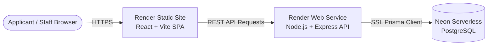

# KICTAMC Portal — Deployment Guide: Render & Neon DB

This guide provides instructions for deploying the **KICTAMC Student Application Portal & Website** to **Render** (Frontend & Backend) with a serverless PostgreSQL database on **Neon.tech**.

---

## 🏗️ Architecture Overview



| Component | Platform | Service Type | Tier / Plan |
|---|---|---|---|
| **Database** | [Neon.tech](https://neon.tech) | Serverless PostgreSQL | Free Tier |
| **Backend API** | [Render.com](https://render.com) | Web Service (Node.js) | Free / Starter |
| **Frontend Web App** | [Render.com](https://render.com) | Static Site (SPA) | Free |

---

## 🚀 Step 1: Create Your Neon PostgreSQL Database

1. Sign up or log in at **[https://console.neon.tech](https://console.neon.tech)**.
2. Click **Create Project**:
   - **Project name**: `kictamc-portal`
   - **Postgres version**: `16` (or latest recommended)
   - **Region**: Choose a region close to your Render deployment (e.g., `US East (Ohio)` or `US West (Oregon)`).
3. Once created, copy the **Connection string** from the Neon dashboard.
   - It will look like:
     ```text
     postgresql://<username>:<password>@<ep-identifier>.region.aws.neon.tech/neondb?sslmode=require
     ```
   > [!NOTE]
   > Keep this connection string ready. You will provide it to Render as `DATABASE_URL`.

---

## ⚡ Step 2: Deploy to Render (Two Options)

### Option A: 1-Click Deployment via Render Blueprint (Recommended)

The repository includes a ready-to-use [`render.yaml`](render.yaml) file.

1. Go to your **[Render Dashboard](https://dashboard.render.com/)**.
2. Click the **New +** button at the top right and select **Blueprint**.
3. Connect your GitHub repository: `https://github.com/bsaccoh/kictamc`.
4. Render will detect `render.yaml` and prompt you for the required environment variables:
   - **`DATABASE_URL`**: Paste your Neon connection string (`postgresql://...@...neon.tech/neondb?sslmode=require`).
   - **`FRONTEND_URL`**: Set this to your frontend URL once created (e.g. `https://kictamc-frontend.onrender.com`).
   - **`VITE_API_URL`**: Set this to your backend URL (e.g. `https://kictamc-backend.onrender.com`).
5. Click **Apply Blueprint**. Render will build and deploy both services automatically!

---

### Option B: Manual Setup on Render

If you prefer to configure each service manually:

#### 1. Backend Web Service
1. In Render, click **New +** → **Web Service**.
2. Connect `https://github.com/bsaccoh/kictamc`.
3. Configure the service settings:
   - **Name**: `kictamc-backend`
   - **Root Directory**: `backend`
   - **Runtime**: `Node`
   - **Build Command**:
     ```bash
     npm install && npx prisma generate && npx prisma db push && npm run build
     ```
   - **Start Command**:
     ```bash
     npm start
     ```
   - **Plan**: `Free`
4. Under **Environment Variables**, add:
   | Key | Value / Note |
   |---|---|
   | `NODE_ENV` | `production` |
   | `PORT` | `10000` |
   | `DATABASE_URL` | *Your Neon connection string with `?sslmode=require`* |
   | `JWT_ACCESS_SECRET` | *Click "Generate" or provide a secure 32+ char string* |
   | `JWT_REFRESH_SECRET` | *Click "Generate" or provide a secure 32+ char string* |
   | `COOKIE_SECRET` | *Click "Generate" or provide a secure 32+ char string* |
   | `FRONTEND_URL` | *Your frontend Render URL (e.g. `https://kictamc-frontend.onrender.com`)* |
   | `STORAGE_DIR` | `./storage` |
   | `EMAIL_PROVIDER` | `console` |
   | `SMS_PROVIDER` | `console` |
5. Set **Health Check Path** to `/api/health`.
6. Click **Create Web Service**.

#### 2. Frontend Static Site
1. In Render, click **New +** → **Static Site**.
2. Connect `https://github.com/bsaccoh/kictamc`.
3. Configure the settings:
   - **Name**: `kictamc-frontend`
   - **Root Directory**: `frontend`
   - **Build Command**:
     ```bash
     npm install && npm run build
     ```
   - **Publish Directory**: `dist`
4. Under **Environment Variables**, add:
   | Key | Value |
   |---|---|
   | `VITE_API_URL` | *Your backend Render URL (e.g. `https://kictamc-backend.onrender.com`)* |
5. Under **Redirects/Rewrites**, add an SPA fallback rule:
   - **Type**: `Rewrite`
   - **Source**: `/*`
   - **Destination**: `/index.html`
6. Click **Create Static Site**.

---

## 📦 Step 3: Seed Academic Catalog & Admin Accounts on Neon

During the backend build, `npx prisma db push` creates all database tables on Neon automatically.

To populate the institutional academic catalog (Faculties, Departments, Courses, Admission Intakes) and default administrative staff accounts onto your Neon database:

### From Your Local Machine (Quickest):
Run the seed script from your local terminal pointing to your Neon database:

```bash
# In the kitcamc-app/backend directory:
DATABASE_URL="postgresql://<user>:<password>@<neon-host>/neondb?sslmode=require" npm run prisma:seed
```

### Or Using Render Shell:
1. Open your `kictamc-backend` service on Render.
2. Go to the **Shell** tab.
3. Run:
   ```bash
   npm run prisma:seed
   ```

---

## 🔍 Step 4: Verification & Smoke Test

Once both services show **Deployed**:

1. **Backend Health Check**:
   - Open: `https://your-backend.onrender.com/api/health`
   - Expect: `{"status":"ok","timestamp":"...","service":"KICTAMC Portal API"}`

2. **Public Course Catalog**:
   - Open: `https://your-backend.onrender.com/api/v1/public/courses`
   - Expect: JSON list of all accredited academic programs.

3. **Frontend Application**:
   - Open your frontend URL: `https://your-frontend.onrender.com/`
   - Verify: Public landing page loads with college photography, academic programs, and active admission intake.
   - Test navigating to `/login`, `/register`, and `/apply`.

---

## 🛡️ Production & Security Considerations

- **Render Free Tier Spin-Down**: Free Render web services go to sleep after 15 minutes of inactivity. The first request after sleep may take ~30–50 seconds to cold start.
- **File Upload Storage**: Render free services have ephemeral local storage. Uploaded applicant documents in `./storage` will reset if the web service restarts. For persistent file uploads in production, consider mounting a [Render Persistent Disk](https://render.com/docs/disks) or configuring S3/Cloudinary.
- **SSL / HTTPS**: Neon and Render both enforce HTTPS and TLS 1.3 by default.
